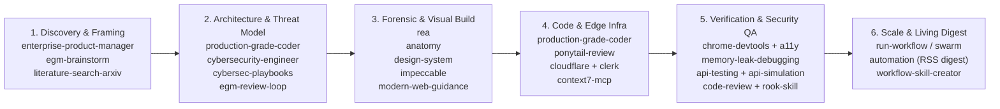

# Antigravity Skills Inventory & Operational Capability Analysis

> **Purpose:** Complete ground-truth audit of every skill, subagent, and MCP server currently installed in your Antigravity environment, filtered and prioritized into an actionable operational toolkit for building **Anatomy of System Design**.
>
> **Audit Method:** Direct scan of `builtin`, `user-global`, and `plugins` skill registries (`344` `SKILL.md` files deduplicated to **273 globally unique skills** across **23 sources**).  
> **Companion Documents:** [01-system-design-concepts-and-newsletters.md](./01-system-design-concepts-and-newsletters.md) · [03-enhanced-idea-and-master-plan.md](./03-enhanced-idea-and-master-plan.md)

---

## 1. Executive Inventory Summary (273 Unique Skills Across 23 Sources)

| Source / Plugin | Unique Skills | Primary Capability Domain | Relevance to *Anatomy of System Design* |
|---|---:|---|---|
| **`user-global`** | **50** | `anatomy`, `production-grade-coder`, `enterprise-product-manager`, `cybersecurity-engineer`, `cybersec-playbooks`, `rea`, design/motion craft, `ponytail`, `playwright-cli` | **CRITICAL (Core Engine)** |
| **`builtin`** | **15** | `swarm`, `run-workflow`, `automation`, `generative_ui`, `mcp-app-development`, `plugin`, `agy-customizations` | **HIGH (Orchestration & Automation)** |
| **`cloudflare`** | **22** | Workers, Next.js on Workers, Durable Objects, R2/Basin, K2 logs, Turnstile, Zero Trust, `web-perf` | **HIGH (Edge Runtime, Hosting, DDoS/WAF)** |
| **`clerk`** | **20** | AuthN/AuthZ, B2B Organizations, SSO/RBAC, Billing/Entitlements, Webhooks, Next.js middleware | **HIGH (Identity, Multi-Tenancy, SaaS Billing)** |
| **`postman`** | **20** | API contracts, testing, mocking, upstream failure simulation, load/perf testing, AI-readiness, CI gates | **HIGH (API QA, Chaos Simulation & Load Testing)** |
| **`egm`** | **7** | Antagonistic Elephant & Goldfish RFC brainstorming, drafting, multi-agent review loop, drift checks | **HIGH (Design Doc & Curriculum Rigor)** |
| **`chrome-devtools-plugin`** | **6** | Visual/DOM inspection, `a11y-debugging`, `debug-optimize-lcp`, `memory-leak-debugging`, `cookie-debugging` | **HIGH (SVG/WebGL Perf, A11y & Runtime QA)** |
| **`coderabbit`** | **4** | Automated PR/local code review, autofix plans, `.coderabbit.yaml` guardrails | **HIGH (Automated Code Quality)** |
| **`gemini-api`** | **4** | Gemini API dev, Live bidirectional WebSocket audio/video, CLI, media generation | **MEDIUM-HIGH (AI Tutor, Newsletter Synthesis, Voice)** |
| **`modern-web-guidance-plugin`** | **2** | Up-to-date HTML/CSS/Web API best practices, Chrome Extensions (MV3) | **MEDIUM-HIGH (Modern Web APIs & Browser Extension)** |
| **`notion`** | **7** | Editorial tracker DB, research docs, spec-to-implementation, weekly digest | **MEDIUM (Optional Editorial CMS / Planning)** |
| **`firebase`** | **13** | Hosting, App Hosting, Auth, Firestore, Data Connect (Postgres), Security Rules | **MEDIUM (Alternative Cloud Stack)** |
| **`mongodb-atlas`** | **7** | Document schema, Hybrid/Vector Search, Stream Processing, Queryable Encryption | **MEDIUM (Optional Document/Hybrid Search Backend)** |
| **`testmu-ai`** | **2** | `kanecli-skill` (cross-browser/mobile E2E), `rook-skill` (AI agent eval & red-teaming) | **MEDIUM (E2E & AI Agent Red-Teaming)** |
| **`context7`** | **1** | Live up-to-date library/framework docs & code examples | **HIGH (Eliminates Stale API Hallucinations)** |
| **`google-developer-knowledge`** | **1** | Official Google Cloud/Web/Chrome/Go/Firebase developer docs | **MEDIUM (Reference Lookup)** |
| **`google-antigravity-sdk`** | **1** | Building custom autonomous multi-agent pipelines | **MEDIUM (Optional Ingestion/Review Agents)** |
| **`auth0`** | **1** | Enterprise AuthN/AuthZ alternative to Clerk | **LOW-MEDIUM (Alternative Auth)** |
| **`databricks`** | **37** | Lakehouse, Unity Catalog, Iceberg, MLflow, Genie, DBSQL, Spark Streaming | **LOW (Optional Enterprise Analytics / Reference Only)** |
| **`science`** | **48** | Bioinformatics/cheminformatics + **`literature-search-arxiv`**, **`literature-search-openalex`**, **`uv`**, **`workflow-skill-creator`** | **SELECTIVE (Only 4 general research/tooling skills apply)** |
| **`android-cli-plugin`** | **3** | Android CLI, Compose Preview, AVD Device Hub | **OUT OF SCOPE (Unless Native Android App in Phase 5+)** |
| **`google_maps_platform`** | **1** | Maps, Places, Routing APIs | **OUT OF SCOPE** |
| **`unity`** | **1** | Unity game development | **OUT OF SCOPE** |
| **TOTAL** | **273** | **Full Multi-Domain Agentic Operating System** | **~85 Directly Useful · 6 Core Mission Drivers** |

---

## 2. Deep-Dive: The Useful Skills List (Tiered for This Operation)

### Tier 1 — Core Mission Engine (The 6 Pillar Skills)

These six skills define the **irreplaceable product DNA** of *Anatomy of System Design*.

| Skill | Location / Scope | Exact Role in This Operation | Why It Is Load-Bearing |
|---|---|---|---|
| **`anatomy`** | `user-global` | **Visual & Simulation Crown Jewel.** Builds interactive isometric SVG/WebGL/3D physical instruments (`iso-kit`, `lathe`, `tube`, `gl`, `turn`), enforces zero-interlock geometry audits (`--audit`), zero stray line-ends (`lines.mjs`), dual dark/light paper themes, and vector **A4/Letter printable posters (`print.mjs`)**. | **The #1 differentiator.** Turns abstract system design boxes-and-arrows into tactile, mathematically faithful physical machines that engineers screenshot, interact with, and print. |
| **`production-grade-coder`** | `user-global` | **Chief Architect & Staff Engineer.** Drives HLD/LLD, Big-O & alternative trade-offs, capacity math, database/distributed-systems patterns, concurrency/idempotency, observability, FinOps, ADRs, and supply-chain security (`SBOM`, `SLSA`). | Guarantees both the **platform codebase** and the **curriculum code blueprints** reflect real production engineering rather than toy interview templates. |
| **`enterprise-product-manager`** | `user-global` | **Product Strategy & Commercialization Brain.** Runs 21-lens product reviews, defines Table Stakes vs Wedge vs Moat, enumerates flow-level edge cases, builds RICE/WSJF roadmaps, SaaS packaging/TCO, and Enterprise Mode compliance/BIA/RACI. | Prevents building a pretty portfolio demo that fails to retain users or monetize B2B engineering teams. |
| **`cybersecurity-engineer`** | `user-global` | **Security Architect & Threat Modeler.** Performs STRIDE/PASTA/LINDDUN threat modeling, Zero Trust (NIST SP 800-207), OWASP Top 10 / API Top 10 / ASVS 5.0 / LLM Top 10 reviews, DevSecOps gates, and CISO/compliance reporting. | Embeds security natively into both our **platform infrastructure** and every **System Design module's "Security X-Ray" layer**. |
| **`cybersec-playbooks`** | `user-global` | **Tactical Security Runbook Engine.** Local zero-dependency BM25 + framework search across **818 playbooks**, **34 security domains**, and **6 frameworks** (`MITRE ATT&CK v19.1`, `NIST CSF 2.0`, `MITRE D3FEND v1.4.0`, `MITRE ATLAS`, `MITRE F3 v1.1`, `NIST AI RMF 1.0`). | Grounds abstract security advice in real, executable CLI/defensive procedures and verified framework IDs without hallucinating control codes. |
| **`rea`** (`reverse-engineer-anything`) | `user-global` | **Forensic Reality Grounding.** Inspects authorized local/lab shipped artifacts (`HAR/SAZ/qlog`, `PCAP`, `SQLite` WAL/B-Trees, `JS/Electron`, `WASM`, `Go`/`Rust` binaries) and exports SHA-256-verifiable Evidence bundles distinguishing *Observation*, *Inference*, and *Unknown*. | Elevates concepts from textbook claims to **empirically verified runtime forensics** ("don't just read how HTTP/3 or SQLite WAL works — inspect the real captured frames"). |

> **Note on Skill Synergy (`_enterprise-commons`):** `enterprise-product-manager`, `production-grade-coder`, and `cybersecurity-engineer` all share a unified enterprise governance foundation (`_enterprise-commons`: Jurisdiction Routing, Data Classification, BIA Tiers, Audit Trails, FinOps, Supply-Chain Risk, Responsible AI) with an explicit conflict hierarchy: **Legal & Safety → Security → Correctness & Reliability → Product Preference → Code Brevity**.

---

### Tier 2 — Interactive Frontend, Design Craft & Motion Polish (20 Skills)

Because *Anatomy of System Design* competes visually with Bartosz Ciechanowski, Stripe Docs, Linear, and Sam Rose, UI craft is not cosmetic — it is the retention loop.

| Skill(s) | Exact Role in This Operation |
|---|---|
| **`brand`** & **`design-system`** & **`design`** | Define the cohesive visual identity ("Precision Engineering Bench"), three-layer design tokens (`primitive → semantic → component`), dark/light paper parity matching `anatomy`'s `ISO_CSS` ramp. |
| **`design-taste-frontend`** / **`taste-skill`** & **`impeccable`** & **`ui-ux-pro-max`** | Anti-slop art direction, editorial typography, layout hierarchy, and critical frontend polish audits so the learning portal looks like an award-winning technical publication, not generic AI-generated cards. |
| **`ui-styling`** & **`pick-ui-library`** & **`prototype`** | Accessible Radix/shadcn primitives + Tailwind styling, curated frontend library picks (command palettes, virtualization, numeric counters), and multi-variant UI prototyping before committing. |
| **`emil-design-eng`** & **`animate`** & **`motion`** / **`framer-motion`** & **`apple-design`** | Tactile spring physics, interruptible transitions, scroll/gesture polish, and restrained micro-interactions around the `anatomy` instruments. |
| **`animation-performance`** & **`review-animations`** & **`find-animation-opportunities`** & **`improve-animations`** | Keep 60fps frame budgets (composite-only properties, offscreen pause, reduced-motion compliance) when SVG + WebGL figures run alongside interactive controls. |
| **`modern-web-guidance`** & **`mobile-native`** & **`break-ui`** | Up-to-date Web APIs (Popover, View Transitions, WebGL2), native-feeling 390px mobile ergonomics (fixing 100vh, tap highlights), and adversarial worst-case UI stress testing (long labels, RTL, zero/extreme counts). |
| **`img2threejs`** & **`generative_ui`** & **`slides`** & **`banner-design`** | Optional procedural Three.js hardware models, quick chat-inline prototypes, launch slide decks, and social OpenGraph/newsletter banners. |

---

### Tier 3 — Specification Rigor, Anti-Bloat Guardrails, Code Review & Multi-Agent Scale (16 Skills)

Building 30–100 interactive concept modules, each with a simulation model, `anatomy` SVG, REA lab evidence, threat model, and code blueprint, is a **high-throughput multi-agent production pipeline**.

| Skill(s) | Exact Role in This Operation |
|---|---|
| **`egm-brainstorm`**, **`egm-draft`**, **`egm-review`**, **`egm-review-loop`**, **`egm-resolve`**, **`egm-drift-report`**, **`egm-bootstrap`** | **Antagonistic Spec & Curriculum Review.** Runs independent Goldfish critics (`egm-zoom-out`, `egm-comprehension`, `egm-design`, `egm-codebase-details`, `egm-implementation-readiness`, `egm-style`, `egm-structural`) to catch logical errors, undefined jargon, or doc-vs-code drift in every RFC and System Design module! |
| **`ponytail`**, **`ponytail-review`**, **`ponytail-audit`**, **`ponytail-debt`** | **Essential Counterbalance to Over-Engineering.** Keeps MVP infrastructure lean (e.g., preventing premature Kubernetes/microservices) while preserving non-negotiable security/supply-chain checks per `_enterprise-commons` precedence. |
| **`code-review`**, **`autofix`**, **`coderabbit-config`** | Automated local and PR code reviews with severity-ranked fixes via CodeRabbit CLI/MCP before merging modules or backend services. |
| **`run-workflow`** & **`swarm`** & **`automation`** | **Parallel Content & Figure Factory.** Use `run-workflow` (Python DAG orchestration) or `swarm` (parallel workers on a shared board) to fan out across independent System Design modules (e.g., 5 workers drafting 5 `anatomy` machines + simulation models + REA evidence bundles simultaneously), and `automation` for recurring weekly newsletter RSS signal digests! |
| **`workflow-skill-creator`** & **`skill-inspector`** | Distill our repeatable *"New System Design Concept Module"* pipeline into a custom workspace skill, and security-vet any third-party skills/tools via NVIDIA SkillSpector before adoption. |

---

### Tier 4 — Platform Infrastructure, Auth, API QA, Browser Perf & Research (35+ Skills)

| Category | Recommended Skills | Exact Role in This Operation |
|---|---|---|
| **Edge Hosting, Compute & DDoS/WAF** | `cloudflare`, `nextjs-on-cloudflare` (or `frameworks-on-cloudflare`), `durable-objects`, `workers-best-practices`, `workers-development`, `workers-profiling`, `turnstile-spin`, `web-perf`, `wrangler`, `cf-cli`, `cloudflare-one` | Global sub-50ms edge delivery of isometric SVG/WebGL/PDF assets, Durable Objects for live collaborative classroom sandboxes & per-tenant rate limits, Turnstile bot protection on public interactive labs, WAF/DDoS shielding, and CPU/memory profiling. |
| **Auth, Multi-Tenant Orgs & Billing** | `clerk`, `clerk-nextjs-patterns`, `clerk-orgs`, `clerk-billing`, `clerk-webhooks`, `clerk-testing` | Fast, secure AuthN + MFA/Passkeys, B2B team workspaces (`clerk-orgs` with RBAC & Enterprise SSO), built-in subscription tiers/entitlements (`clerk-billing`), and HMAC-verified webhook syncing. |
| **API Design, Contract, Chaos & Load QA** | `api-engineer`, `api-documentation`, `api-testing`, `api-simulation`, `api-mocking`, `performance-testing`, `application-testing`, `ci-integration`, `ai-readiness`, `mcp-testing` | Contract-first OpenAPI `/v1/` specs, upstream failure simulation (`429`/`5xx`/timeouts) in CI, k6/Postman load testing for 10x scale verification, Playwright-to-contract coverage checks, and MCP server testing if we expose a **System Design Knowledge MCP**! |
| **Browser Perf, A11y & Visual Verification** | `chrome-devtools`, `a11y-debugging`, `debug-optimize-lcp`, `memory-leak-debugging`, `cookie-debugging`, `playwright-cli`, `kanecli-skill` | Headless Chrome auditing of `anatomy` WebGL memory leaks (preventing GPU context leaks across route transitions!), WCAG 2.2 AA accessibility checks, LCP optimization, cookie/session verification, and cross-browser E2E tests. |
| **AI Tutor, Evals & Red-Teaming** | `gemini-api-dev`, `gemini-live-api-dev`, `rook-skill` | Grounded Socratic System Design AI tutor & live voice mock-interview mode (Phase 3+), strictly regression-tested and adversarial red-teamed via `rook-skill` + `cybersec-playbooks` (`testing-prompt-injection-in-rag-pipelines`). |
| **Primary Literature & Live Docs** | `literature-search-arxiv`, `literature-search-openalex`, `context7-mcp`, `retrieving-developer-knowledge` | Pull original distributed-systems/AI inference papers (arXiv/OpenAlex) directly into curriculum citations, and verify live library APIs (Next.js, Drizzle, OpenTelemetry, vLLM) via `context7-mcp`. |
| **Optional Knowledge/Workspace Ops** | `notion-database-designer`, `notion-spec-to-implementation`, `mcp-app-development` | Optional editorial calendar in Notion; or packaging *Anatomy of System Design* figures directly as an **Antigravity MCP App** rendering interactive isometric instruments inside AI IDEs! |

---

### Tier 5 — Available Built-in Subagents & MCP Servers to Leverage

Beyond skills, Antigravity gives us active runtime primitives we should wire into our workflow:
- **Subagents:**
  - `research`: Deep read-only codebase/web research for new system design case studies & newsletter mining.
  - `browser`: Live interactive browser verification of rendered `anatomy` figures, dark/light theme toggles, and interactive controls.
  - `code-reviewer` & `autofix`: CodeRabbit automated quality/security gates.
  - `egm-*` (`egm-zoom-out`, `egm-comprehension`, `egm-design`, `egm-codebase-details`, `egm-implementation-readiness`, `egm-style`, `egm-structural`, `egm-synthesizer`): Multi-persona technical review board for every curriculum chapter and platform ADR.
  - `image-generator`: High-craft editorial hero/banner assets (never replacing `anatomy`'s crisp parametric SVGs).
- **MCP Servers:**
  - `chrome_devtools_full` (live LCP, console, heap snapshots, screenshot & a11y audits)
  - `context7` (up-to-date framework docs)
  - `cloudflare_cloudflare` (Workers/R2/D1/KV docs & live deployment inspection)
  - `clerk_clerk` (application, org, user, and instance security verification)
  - `projectbrain` (codebase dependency graph, impact analysis, flow tracing & claim verification once the repo grows)
  - `sequential-thinking` (complex distributed-system capacity/failure trade-off analysis)
  - `testmu-ai_testmu-ai` (visual regression via SmartUI & cross-device testing)

---

### Tier 6 — Explicitly Excluded / Out-of-Scope Skills

To avoid context bloat and scope creep, **do not load**:
- 44 life-sciences / genomics / cheminformatics skills inside the `science` plugin (keep only `literature-search-arxiv`, `literature-search-openalex`, `uv`, and `workflow-skill-creator`).
- `unity`, `android-cli-plugin`, `google_maps_platform`, `write-swift`, `animate-expo`.
- `databricks` (37 skills) and `mongodb-atlas` (7 skills) — unless later needed for an enterprise analytics warehouse or specific database lab target; PostgreSQL + R2/Iceberg covers our core platform more simply.

---

## 3. Recommended Stage-by-Stage Skill Choreography

### Key Conflict-Resolution Rules Between Active Skills
1. **`production-grade-coder` vs `ponytail`:** Default to `ponytail` for infrastructure topology (Modular Monolith + PostgreSQL + Cloudflare Edge over premature Kubernetes/microservices), while strictly enforcing `production-grade-coder`'s non-negotiables (Big-O, idempotency, observability, supply-chain SBOM/pinning, error handling).
2. **`cybersecurity-engineer` vs Feature Speed (`enterprise-product-manager`):** Legal/safety and Critical/High exploitable security flaws ALWAYS override feature velocity (Mandatory Override Lane).
3. **`rea` Boundaries:** Use `rea` strictly for real artifact captures (HAR/SAZ/qlog, PCAP, SQLite WAL, WASM, compiled Go/Rust binaries from self-hosted open-source labs) — skip `rea` for ordinary source-code analysis of our own repo.
4. **`anatomy` vs Generic Diagrams:** Use `anatomy` for every flagship interactive system-design mechanism (40–150+ solid parts, `--audit` zero errors, `lines.mjs` zero loose ends, dark+light themes, printable A4 PDFs); reserve Mermaid strictly for architecture/trust-boundary schematics in engineering docs.
