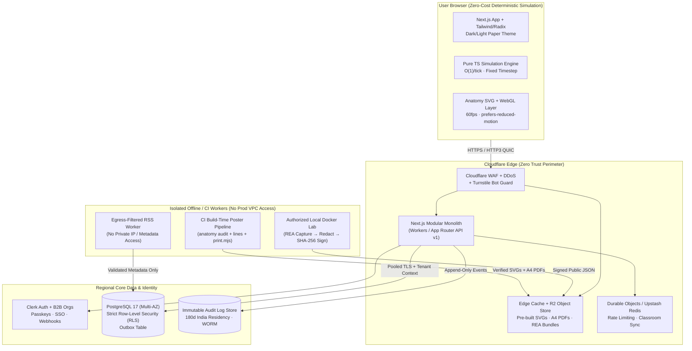
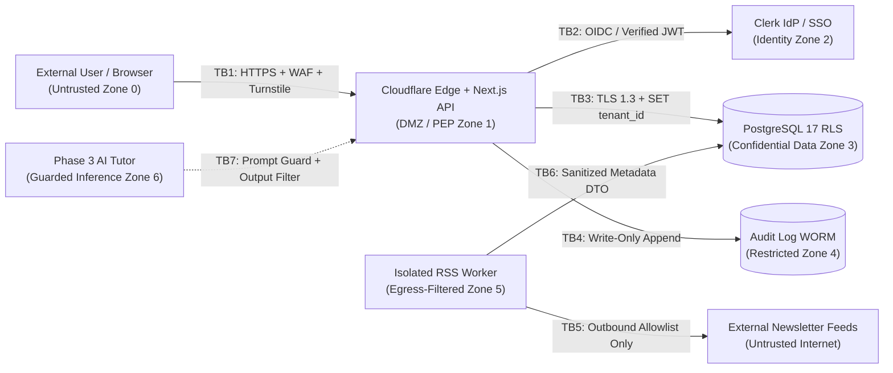

# Anatomy of System Design — Enhanced Concept & 5-Skill Master Plan

> **Synthesized Using 5 Specialist Antigravity Skills (+ `anatomy`):**  
> `/enterprise-product-manager` · `/production-grade-coder` · `/rea` · `/cybersecurity-engineer` · `/cybersec-playbooks` · (`anatomy` visual engine)
>
> **Companion Documents:** [01-system-design-concepts-and-newsletters.md](./01-system-design-concepts-and-newsletters.md) · [02-antigravity-skills-analysis.md](./02-antigravity-skills-analysis.md)

---

## 0. The Enhanced Idea: What *Anatomy of System Design* Becomes

A plain "System Design concepts Markdown + newsletter aggregator" enters a crowded red ocean dominated by *ByteByteGo*, *System Design Newsletter*, *Quastor*, *Hello Interview*, and *System Design Primer*.

By fusing all five requested skills with Antigravity's `anatomy` visual engine, we transform this into a **category-defining interactive engineering workbench**:

> **One-Sentence Wedge:** *Anatomy of System Design* is the first interactive System Design platform where every distributed-systems concept is experienced as a **precision physical instrument (`anatomy`)** backed by **deterministic math & production code (`/production-grade-coder`)**, **SHA-256-verifiable runtime artifact forensics (`/rea`)**, and a live **toggleable Attack-Defense Security X-Ray (`/cybersecurity-engineer` + `/cybersec-playbooks`)**.

### The 4-Layer "Dissection Bench" Per Concept Module
Every concept (e.g., *Token Bucket Rate Limiter*, *LSM-Tree Compaction*, *Raft Leader Election*, *Consistent Hashing Ring*, *HTTP/3 QUIC Streams*, *Zero-Trust mTLS Airlock*, *vLLM PagedAttention KV-Cache*) ships with four synchronized, interactive tabs:

1. **Layer 1 — The Physical Machine (`anatomy`):** A dense 40–150+ part interactive isometric SVG (+ optional WebGL/3D) physical mechanism driven by a pure mathematical simulation module (`model.ts`). Readers drag sliders (traffic spike, partition shutter, write skew, cache TTL, compaction threshold) and watch pressure gauges, latches, and dials react at 60fps in dark or light paper mode — plus one-click export to vector **A4/Letter Technical Posters** (`poster`, `drawing`, `detailed` PDFs).
2. **Layer 2 — Production Blueprint (`/production-grade-coder`):** HLD + LLD, Big-O time/space complexity & rejected alternatives, back-of-envelope capacity math (Base & 10x), idiomatic production code (TypeScript/Go/Rust/SQL) with idempotency, structured OTel observability, and FinOps unit-cost breakdown.
3. **Layer 3 — Under the Microscope (`/rea` Forensic Lab):** Real, reproducible artifacts captured from authorized self-hosted open-source reference stacks (SQLite WAL/B-tree pages, Wireshark 4.x TCP/TLS/DNS PCAPs, aioquic HTTP/3 qlog traces, HAR/SAZ exchanges, Go/Rust binary dependency graphs, WASM modules). Every claim is strictly partitioned into **Observed Evidence (with Evidence ID & SHA-256)**, **Inferences**, and **Unknowns**.
4. **Layer 4 — Security X-Ray & Defensive Playbooks (`/cybersecurity-engineer` + `/cybersec-playbooks`):** Flip the **"Security X-Ray" switch** on the physical instrument to reveal STRIDE trust boundaries, simulate realistic attack stress (Retry Storm, BOLA, Hash-DoS, Cache Poisoning, SSRF, Indirect Prompt Injection), view mapped compliance/framework IDs (`OWASP API Top 10`, `MITRE ATT&CK v19.1`, `NIST CSF 2.0`, `MITRE D3FEND v1.4.0`, `MITRE ATLAS`, `NIST 800-53 Rev.5`), and launch concrete defensive playbooks from the 818-playbook runbook index.
5. **Living Horizon — Weekly Newsletter Signal Radar:** Automated, copyright-safe RSS/Atom ingestion of the 25+ top newsletters and big-tech engineering blogs (metadata + link + original architectural synthesis mapped directly onto the 14-domain concept graph).

---

## 1. Executive One-Page Summary (Enterprise Mode Decision Brief)

- **Decision Needed First:** Approve **Option B (Phased Interactive Dissection Workbench — Modular Monolith on Edge + 12 Flagship Machines First)** as the Phase 1–3 build target, and confirm home-market jurisdiction defaults (India-first + global EU/US audience).
- **Strategic Exposure & Opportunity [Illustrative]:**
  - **Cost of Doing Nothing / Building a Generic Static Site:** Zero organic virality against *ByteByteGo* (1M+ subscribers) and *Hello Interview*; high probability of <1% free-to-paid conversion and abandonment within 90 days.
  - **Security/Compliance Exposure if Built Naively [Illustrative]:** Unsandboxed headless-Chrome PDF export or unguarded RSS ingestion creates Critical SSRF/RCE exposure; un-isolated B2B multi-tenant data risks regulatory penalties under India DPDP Act 2023 (up to ₹250 crore statutory ceiling — *verify against notified Rules*) and EU GDPR Art. 83 (up to 4% global turnover).
- **Options Comparison:**

| Option | Scope | Est. Infra + Tooling Cost (Yr 1) | Time to First Public Launch | Recommendation |
|---|---|---:|---|---|
| **Option A: Static Markdown + Newsletter Site** | Curated MD docs + RSS list | \$50–\$300/yr [Typical] | 1–2 weeks | **Reject.** Commodity parity; no wedge, no shareable visual artifact, no B2B pricing power. |
| **Option B: Phased Interactive Workbench (12 Flagship Modules → B2B SaaS)** | Modular Monolith (Next.js + Cloudflare Edge + Postgres RLS), 12 interactive `anatomy` machines, REA Lab bundles, Security X-Ray, A4 Posters | \$1,200–\$4,800/yr base; \$12k–\$30k/yr at 10x [Illustrative] | 6–8 weeks to public MVP (3 flagship machines); 16 weeks to 12-module v1 | **RECOMMENDED.** Strongest differentiation, sub-linear compute (client-side sim), clear PLG → Enterprise path. |
| **Option C: Full Microservices + Cloud Sandbox Clusters + AI Voice from Day 1** | K8s cluster, live per-user Docker labs, multi-agent voice | \$35,000–\$90,000/yr [Illustrative] | 6–9 months | **Reject.** Massive premature operational/security/FinOps burn before demand validation. |

- **Domain Traffic-Light Readiness (Pre-Build Baseline):**

| Domain | Status | Explicit Criteria |
|---|---|---|
| **Product Wedge & Differentiation** | **GREEN** | Unique 4-layer synthesis (`anatomy` + `REA` + Security X-Ray + Production Code) validated against market gaps. |
| **Visual & Simulation Feasibility** | **GREEN** | `anatomy` kit (`iso-kit`, `lathe`, `tube`, `gl`, `audit.mjs`, `print.mjs`) already installed and verified locally. |
| **Architecture & Cost Scalability** | **GREEN** | Client-side deterministic simulation keeps marginal compute near zero; Modular Monolith + Postgres RLS is proven. |
| **Security & Sandboxing** | **AMBER** | Two Critical pre-build attack surfaces (RSS SSRF, Headless Chrome PDF export) require hard isolation before launch. |
| **Compliance & EdTech Minors** | **AMBER** | Global developer/student audience triggers India DPDP + CERT-In + EU GDPR; age-gate & consent UX must ship in MVP. |
| **REA Forensic Lab Pipeline** | **AMBER** | Requires strict CI pipeline capturing only authorized local open-source containers + automated redaction gates. |

---

## 2. Lens 1 — Product Strategy, Edge Cases & Roadmap (`/enterprise-product-manager`)

### 2.1 Competitive Positioning: Table Stakes vs. Wedge vs. Moat
- **Table Stakes (Expected, earns zero credit alone):** Clean system design syllabus, dark/light mode, search, code snippets, mobile readability, RSS links to engineering blogs.
- **The Wedge (Day-1 switch trigger):** Tactile, physically accurate isometric machines (`anatomy`) you can break in real time + flip into **Security X-Ray** and **REA Forensic Evidence** + export as print-ready **A4 Engineering Posters**. *Engineers will screenshot and share a moving LSM-Tree Compaction Press or Raft Ballot Escapement unprompted on LinkedIn/X/Slack.*
- **The Moat (7 Powers — Counter-Positioning & Process Power):**
  1. **Process Power:** Building 40–150 part geometry-audited, physics-driven interactive machines paired with reproducible REA artifact bundles + mapped MITRE/NIST playbooks is prohibitively slow for newsletter writers without our multi-agent Antigravity pipeline (`anatomy` + `rea` + `cybersec-playbooks` + `swarm`).
  2. **Workflow Embeddedness (B2B Expansion):** Enterprise engineering teams adopt *Anatomy* not for interview prep, but as their **Onboarding, Architecture Review (ADR/RFC), and Threat-Modeling Reference Standard** with custom private diagrams and compliance evidence exports.

### 2.2 Ranked Proposed Ideas (Opinionated Selection)

1. **Interactive "Break the Machine" Chaos Sliders + Security X-Ray Overlay** *(Ranked #1)*
   - **Hook:** Every system design primitive is a physical machine you can deliberately stress until it breaks (packet loss, clock skew, hot key, BOLA probe, retry storm), then toggle controls to watch stability return.
   - **User:** Mid-to-Staff backend/infra engineers, interview candidates, AppSec engineers.
   - **Effort:** M (per flagship module; amortized to S once shared `SimulationCard` harness is built).
   - **Why it's different:** Competitors show static happy-path diagrams; we teach *failure physics and adversary physics* interactively.
2. **Vector A4/Letter "Wall Poster & ADR Handout" Generator (`anatomy` `print.mjs`)** *(Ranked #2)*
   - **Hook:** One click turns any interactive machine's live state into a crisp, vector-sharp A4 technical poster, engineering drawing, or 4-page multi-step assembly guide for office walls and RFC appendices.
   - **User:** Tech leads, Staff engineers, engineering educators, university labs.
   - **Effort:** S (leverages `anatomy/scripts/print.mjs` directly, built statically at CI time to eliminate runtime PDF DoS!).
   - **Why it's different:** Creates a high-status physical/PDF shareable artifact with built-in organic brand attribution (PLG viral loop).
3. **"Under the Microscope" REA Forensic Evidence Drawer** *(Ranked #3)*
   - **Hook:** Click any pipe, disk, or packet on the machine to inspect a real, SHA-256-verified capture from an actual Postgres/SQLite/Envoy/QUIC/etcd instance — separating hard observations from inferences.
   - **User:** Senior/Staff engineers tired of hand-wavy blog summaries who want ground-truth bytes and schemas.
   - **Effort:** M (build reproducible Docker lab capture harness once; run per module).
   - **Why it's different:** Zero system design education platforms ship empirical, tamper-evident runtime forensic evidence bundles alongside conceptual models.
4. **Enterprise "Architecture Review & Threat-Model Pack" (B2B Team Mode)** *(Ranked #4)*
   - **Hook:** Teams annotate system design modules with their own internal ADRs, export pre-mapped STRIDE + NIST 800-53 / ISO 27001 / MITRE ATT&CK audit packs, and track engineer mastery for SOC 2 / Security Champions programs.
   - **User:** VP Engineering, Staff Architects, AppSec Leads, Engineering Enablement teams.
   - **Effort:** L (requires multi-tenant Postgres RLS, Clerk Organizations SSO/SCIM, audit logging).
   - **Why it's different:** Turns a "vitamin" consumer study site into a "painkiller" B2B budget item (Engineering Onboarding + Compliance/Security Training).
5. **Living Newsletter Signal Graph (Weekly Curated Diff)** *(Ranked #5)*
   - **Hook:** Automatically maps new posts from 25+ top newsletters/engineering blogs onto the exact machine/domain they update (e.g., *"New Discord ScyllaDB post → links to Domain 4 LSM Compaction Press"*).
   - **User:** Busy Staff+ engineers who suffer from newsletter inbox fatigue.
   - **Effort:** S–M (scheduled RSS metadata fetcher + human/AI editorial synthesis).
   - **Why it's different:** Converts ephemeral inbox noise into a structured, evergreen architectural index.

> **Explicitly Rejected / Weak Ideas (Do Not Build):**
> - *Generic "AI Chatbot Wrapper" on Day 1:* Commodity AI veneer with high token cost, hallucination liability, and indirect prompt injection surface. Defer to Phase 3 only as a strictly grounded, eval-gated Socratic mock-interviewer.
> - *Live Cloud-Hosted Docker/K8s Sandboxes Per Free User:* Catastrophic cryptomining/abuse surface and super-linear cloud bill. Replace with zero-cost deterministic client-side WebAssembly/TypeScript simulations + pre-captured offline REA Evidence Bundles.
> - *Web3 / Blockchain Certificates for Course Completion:* Pure hype; a cryptographically signed Verifiable Credential (Ed25519 JSON-LD) or standard signed URL achieves integrity at 1/1000th the cost and UX friction.

### 2.3 Exhaustive Flow-Specific Edge Cases

| User / System Flow | Specific Edge Cases to Engineer For |
|---|---|
| **Interactive `anatomy` Simulation** | WebGL context loss or disabled GPU (`--no-webgl` graceful pure-SVG fallback); user drags slider rapidly to boundary (`0` nodes, `100,000` QPS, `100%` packet loss) causing NaN/divide-by-zero in physics model; `prefers-reduced-motion` freezes idle tour to static readable state; multiple figures on one page exhausting browser WebGL context cap (max 8–16 contexts → enforce offscreen pause & single active WebGL lifecycle); 390px mobile viewport touch-drag colliding with vertical page scroll. |
| **A4 PDF Poster Export** | User tries to trigger dynamic server-side Chrome rendering in a tight loop (cost/CPU DoS → **pre-render canonical posters at CI build time onto R2 CDN**; custom team PDFs strictly rate-limited + queued + isolated); non-Latin/RTL custom team title overflowing engraved label plate; broken font fallback in headless print. |
| **REA Forensic Evidence Viewer** | Large PCAP/HAR/SQLite evidence bundles (>10 MB) crashing mobile browsers (paginate via summary-first index + virtualized table); accidental secret/cookie/IP leakage in a lab capture (automated CI secret/PII scrubber + fail-closed schema validator before publishing); SHA-256 mismatch between displayed summary and downloadable JSON bundle. |
| **Newsletter Signal Ingestion** | Malicious RSS feed returning redirect chain to `http://169.254.169.254` (SSRF) or 500 MB XML billion-laughs zip bomb; feed temporarily returns 429/503 or malformed UTF-8; duplicate syndicated articles across Substack + Medium + personal blog (canonical URL + SimHash deduplication); copyright risk (store **strictly title, author, publication date, URL, and our own original architectural synthesis** — never republish full article bodies). |
| **B2B Multi-Tenant Workspaces & Auth** | Tenant A user manipulates UUID in `/v1/workspaces/:id/adrs/:adrId` (BOLA → enforce Postgres RLS + server-side org claim check); shared Redis cache key missing `tenant_id` prefix causing cross-tenant bleed; user removed from IdP/SSO while holding an active JWT (short 5–15 min access token + session revocation webhook from Clerk); deleted user still referenced as ADR author (pseudonymized tombstone preserving audit integrity). |
| **Billing, Quotas & Offline/2G** | Duplicate Stripe/Clerk webhook delivery creating double entitlements (idempotency table on `event_id`); user hits quota mid-export; slow 2G/3G Indian/emerging-market mobile network loading heavy JS (ship zero-JS SSR HTML + precomputed static SVG first paint, lazy-hydrate interactive controls). |
| **Enterprise Compliance & EdTech** | Under-18 student signs up from India (DPDP Act s.9 verifiable parental consent + zero behavioral tracking/ads) or EU/US (GDPR Art. 8 / COPPA); user requests right-to-erasure while India CERT-In requires 180-day ICT log retention (segregate minimal anonymized security logs on documented legal basis, erase profile/PII across primary DB, replicas, search, and caches); legal hold colliding with deletion request. |

### 2.4 Monetization, Packaging & Unit Economics (PLG + Sales-Assist Hybrid)

| Tier | Target Buyer | Price [Illustrative] | Value Metric & Gated Entitlements |
|---|---|---:|---|
| **Explorer (Free)** | Global engineers, students | \$0 | All 14-domain text taxonomy, Weekly Newsletter Signal Radar, 4 flagship interactive `anatomy` machines, watermarked preview PNGs. |
| **Pro Engineer** | Individual SDE-2 → Staff engineers | \$15/mo or \$120/yr | Full library of 30+ interactive machines, Security X-Ray mode, REA Forensic Evidence downloads, unwatermarked vector A4/Letter PDF posters, production code kits. |
| **Team / Enterprise** | Engineering Orgs (10–1,000+ seats), Universities | \$25/seat/mo (annual) | Clerk Orgs SAML/OIDC SSO + SCIM, private Architecture Review & STRIDE Threat-Model Workspaces, custom compliance/MITRE export packs, Security Champions mastery analytics, SLA + DPA. |

### 2.5 Enterprise Mode Governance: Jurisdiction, Data Classification, BIA & RACI

#### Jurisdiction Routing (India-First Default + Global EU/US)
- **Assumptions:** Organization established in India; global developer & learner audience (India, EU/UK, US); primary hosting on Cloudflare Global Edge + regionalized PostgreSQL (`ap-south-1` Mumbai primary for Indian tenant residency + `eu-central-1` Frankfurt option for EU Enterprise tenants); B2C credit-card payments via PCI-compliant processor (Stripe/Razorpay — zero PAN stored on our servers); student/learner EdTech overlay active.
- **Applicable Regimes (Strictest-Rule Resolution):**
  1. **India — DPDP Act 2023 & Rules 2025 [Tier A]:** Notice & purpose-limited consent, Data Principal access/correction/erasure/grievance rights, under-18 age-gate + verifiable parental consent + no behavioral tracking/targeted ads for minors. *(Verify phased enforcement dates — consent manager Nov 2026 / core duties May 2027 — against official MeitY Gazette with counsel.)*
  2. **India — IT Act 2000 & CERT-In Directions (2022) [Tier A]:** **6-hour** breach reporting clock for listed cyber incidents; **180-day** ICT log retention inside India; NTP clock sync to NIC/NPL.
  3. **EU — GDPR [Tier A] + CRA / AI Act [Tier A where applicable]:** Art. 6 lawful basis, Art. 25 Privacy-by-Design, Art. 32 security, **72-hour** breach notification; if Phase 3 AI Tutor ships, classify as limited-risk transparency-obligated AI under EU AI Act (not high-risk grading/admission); SBOM/vulnerability reporting readiness for downloadable developer tools (CRA).
  4. **US — CCPA/CPRA [Tier B] + COPPA / FERPA [Tier B]:** Opt-out/deletion rights; strict minor protection; institutional student record safeguards if sold to US universities.
  5. **Accessibility [Tier B]:** WCAG 2.2 AA, India RPwD Act 2016 / GIGW, European Accessibility Act (keyboard-operable SVG controls, ARIA live readouts, high-contrast light/dark modes, reduced-motion compliance).
- **Consolidated Breach Clock:** Run every P1/P2 security incident to the shortest statutory clock (**6 hours CERT-In**, then **24h NIS2/CRA**, **72h GDPR**, plus DPDP Board & affected users) on one unified incident timeline.

#### Data Classification Table (`_enterprise-commons/data-classification.md`)

| Dataset / Asset | Owner | Class | Encryption & Controls | Retention |
|---|---|---|---|---|
| Curriculum MD, static SVG machines, public REA open-source lab bundles, newsletter metadata | Content Lead | **Public** | HTTPS/TLS 1.3; signed SHA-256 manifests | Indefinite (Git versioned) |
| Aggregated anonymized product telemetry (non-minor, non-PII) | Product Lead | **Internal** | TLS 1.3 + AES-256 at rest; no cross-site tracking | 24 months [Typical] |
| User accounts (email, name, org role), private team ADRs, custom threat models, support tickets | Engineering / Tenant Admin | **Confidential** | TLS 1.3, AES-256, Postgres RLS, masked in logs, DPA required for processors, regionalized storage | Active subscription + 30d grace (then verified erasure) |
| Auth tokens/session keys, KMS keys, Stripe/Clerk webhook secrets, minor consent records, immutable audit logs | Security Lead | **Restricted** | KMS/HSM managed keys, short-lived OIDC/JWT, **NEVER logged or sent to LLMs/analytics**, break-glass audited access | Secrets rotated ≤90d; CERT-In ICT logs 180d segregated |

#### Business Impact Analysis (BIA) Tiers (`_enterprise-commons/bia-and-criticality.md`)

| Business Service | BIA Tier | Target RTO | Target RPO | Resilience Strategy | Drill Cadence |
|---|---|---:|---:|---|---|
| Public Interactive Docs, Isometric Figures & Pre-built Posters (CDN/R2) | **Tier 2** | < 15 min [Typical] | ~0 (Git + R2 multi-region) | Cloudflare Edge + immutable Git rebuild | Quarterly |
| Auth, Multi-Tenant B2B Workspaces, Postgres RLS, Billing Webhooks | **Tier 1 (Enterprise)** / **Tier 2 (MVP)** | < 1 hr | ≤ 5 min (PITR WAL) | Multi-AZ Managed Postgres w/ PITR + 3-2-1 immutable offsite backups | Semi-annual restore drill |
| Async Newsletter Signal Ingester & Custom Team PDF Worker | **Tier 3** | 24 hr | 24 hr | Durable queue replay + idempotent cron | Semi-annual |
| Local REA Lab Capture Harness & CI Build Pipelines | **Tier 4** | 72 hr | Rebuild from Git | Declarative Docker/IaC rebuild | Annual |

#### RACI Matrix (Solo Founder / Lean Team → Enterprise Scale)

| Workstream | Product (EPM) | Staff Eng (PGC) | Security (CSE) | Visual/Content (`anatomy`/`rea`) | Legal/Counsel |
|---|---|---|---|---|---|
| Curriculum & Wedge Prioritization | **A / R** | C | C | R | I |
| Platform HLD/LLD & Edge Code | C | **A / R** | C | I | I |
| `anatomy` Machines & REA Lab Bundles | C | C | R (redaction gate) | **A / R** | I |
| Threat Model, Security X-Ray & Playbooks | C | R (fixes) | **A / R** | C | I |
| Privacy/DPDP/GDPR/Enterprise Contracts | A | C | R (controls) | I | **C / Sign-off** |

### 2.6 Prioritized Roadmap (RICE/WSJF + Mandatory Override Lanes)

**Mandatory Override Lanes (Ranked Outside RICE):**
1. **Security & Legal Fixed Gates:** Zero SSRF on RSS fetcher, zero untrusted dynamic Chromium rendering in MVP, Postgres RLS tests, India DPDP age-gate & privacy notice before public signup.
2. **Reliability & Craft Reserve:** 20% capacity reserve [Typical] for `anatomy` `--audit` / `lines.mjs` fixes, WebGL memory-leak tests, and dependency CVE patching.

| Feature / Milestone | Reach (Qtr) [Illus.] | Impact (0.25–3) | Confidence | Effort (wks) | RICE Score | Horizon |
|---|---:|---:|---:|---:|---:|---|
| 3 Flagship `anatomy` Interactive Machines + Static A4 Posters (Rate Limiter, Consistent Hashing, LSM-Tree) | 5,000 | 3.0 | 90% | 3 | **4,500** | **Now** |
| Core Modular Monolith Web Portal (Next.js on Cloudflare + Design System + Dark/Light + 14-Domain Syllabus) | 5,000 | 2.0 | 95% | 2 | **4,750** | **Now** |
| REA Forensic Evidence Harness + First 3 Verified Lab Bundles (SQLite WAL, HTTP/3 qlog, Redis Lua) | 3,000 | 2.5 | 85% | 2 | **3,188** | **Now** |
| Security X-Ray Overlay + `cybersec-playbooks` 6-Framework Cards | 4,000 | 2.5 | 90% | 2 | **4,500** | **Now / Next** |
| Hardened Weekly Newsletter Signal Radar (SSRF-safe RSS + Curated Synthesis) | 4,000 | 1.5 | 85% | 1.5 | **3,400** | **Next** |
| Expansion to 12 Flagship Interactive Machines (Raft, Circuit Breaker, QUIC, MVCC, Outbox, PagedAttention, Zero Trust, Cells, H3) | 15,000 | 3.0 | 85% | 6 | **6,375** | **Next** |
| Clerk Auth + Pro Billing + B2B Team Workspaces (Postgres RLS + ADR/Threat-Model Exports) | 2,000 | 2.5 | 80% | 4 | **1,000** (High ACV) | **Next / Later** |
| Grounded Socratic AI System Design Mock-Interviewer (Gemini + Guardrails + `rook-skill` Red-Team) | 8,000 | 2.0 | 65% | 5 | **2,080** | **Later** |
| Antigravity / IDE MCP App (`mcp-app-development`) serving live `anatomy` figures inside IDEs | 3,000 | 2.0 | 70% | 3 | **1,400** | **Later** |

---

## 3. Lens 2 — Production-Grade System Architecture & Engineering Plan (`/production-grade-coder`)

### 3.1 Requirements, Scale Assumptions & Back-of-Envelope Capacity Math

- **Explicit Scale Assumptions [Illustrative]:**
  - **Base (Launch / Year 1):** 10,000 MAU · 2,000 DAU · 20 page/API interactions per DAU/day · Peak-to-average ratio 5x (Hacker News / LinkedIn viral spike).
  - **10x Scale (Year 2):** 100,000 MAU · 20,000 DAU · 500 B2B teams (avg 20 seats = 10,000 B2B seats) · 5x peak.
- **Numeric Non-Functional Requirements (SLOs):**
  - Public module page TTFB (Edge cached): **p95 < 100 ms**, LCP **< 1.8 s** on 4G mobile.
  - Interactive simulation frame rate: **60 fps** (frame budget ≤ 16.6 ms; JS tick < 2 ms).
  - Authenticated Workspace API latency: **p95 < 150 ms**, **p99 < 400 ms**.
  - Availability: **99.95%** public static/edge; **99.9%** authenticated B2B API.
- **Capacity Estimation (Base → 10x):**
  - **Average QPS:** Base `2,000 × 20 / 86,400 ≈ 0.5 QPS` (Peak 5x + HN spike: ~50–200 QPS — 95% absorbed by CDN Edge!). 10x: `20,000 × 20 / 86,400 ≈ 5 QPS` avg (Peak burst ~1,000 QPS edge / ~50 QPS origin API).
  - **Storage:** 50 modules × (150 KB static SVG/JS + 2 MB A4 PDFs + 500 KB REA evidence JSON) ≈ **135 MB** total static assets (fits trivially in Cloudflare R2 free/pennies tier). Relational DB at 10x: 100k users + 50k ADRs/progress rows + 180-day audit logs ≈ **< 15 GB** (comfortably handled by a single Managed PostgreSQL 17 primary + 1 standby!).
  - **Bandwidth:** At 10x (20k DAU × 3 MB avg page + poster download) ≈ **60 GB/day (~1.8 TB/mo)** — Cloudflare R2 has **\$0 egress fees**, making unit economics dramatically cheaper than AWS S3 + CloudFront!
  - **Key Architectural Insight:** Because all interactive `anatomy` physics/simulation engines run **deterministically in client-side TypeScript/WebGL**, simulation compute scales at **$O(1)$ server cost regardless of traffic spikes!**

### 3.2 High-Level Design (HLD) — Modular Monolith on Edge (No Premature Microservices!)



### 3.3 Low-Level Design (LLD): Core Contracts, Schema & Algorithms

#### 1. Pure Deterministic Simulation Engine Contract (`O(1)` per tick)
```ts
// Language: TypeScript 5.x (strict), zero runtime dependencies
export interface SimulationEngine<TParams, TState, TMetrics> {
  readonly id: string;
  readonly version: string;
  initialState(params: TParams): TState;
  /** Pure deterministic transition: O(1) or O(k) where k = bounded node count (<= 32) */
  step(state: TState, params: TParams, dtMs: number): TState;
  /** Derived live readout + security invariant violations for the Anatomy plate */
  deriveMetrics(state: TState, params: TParams): TMetrics;
}
```
- **Complexity & Alternatives Check:**
  - *Chosen:* Fixed-timestep pure state reducer (`dt = 16ms`, clamped accumulator `<= 100ms` to prevent spiral-of-death after tab backgrounding), **Time $O(k)$** per frame ($k \le 32$ nodes/buckets = constant < 0.3 ms), **Space $O(k)$** fixed ring buffers (zero per-frame heap allocations → prevents GC jank and memory leaks!).
  - *Rejected Alternative:* Server-side WebSocket streaming simulations or React `useState` per animation frame. Server simulation causes $O(U)$ linear cloud cost and network jitter; React per-frame state triggers full DOM reconciliations (violating `anatomy`'s ref-mutation rule).

#### 2. Multi-Tenant PostgreSQL 17 Schema with Enforced Row-Level Security (RLS)
```sql
-- PostgreSQL 17+ | Multi-tenant defense-in-depth (prevents cross-tenant leak even on ORM bug)
CREATE TABLE tenants (
  id           UUID PRIMARY KEY DEFAULT uuidv7(), -- k-sortable, B-Tree index friendly
  slug         TEXT UNIQUE NOT NULL,
  residency    TEXT NOT NULL CHECK (residency IN ('in-mumbai', 'eu-frankfurt', 'us-east')),
  plan_tier    TEXT NOT NULL CHECK (plan_tier IN ('free', 'pro', 'enterprise')),
  created_at   TIMESTAMPTZ NOT NULL DEFAULT now()
);

CREATE TABLE workspace_adrs (
  id           UUID PRIMARY KEY DEFAULT uuidv7(),
  tenant_id    UUID NOT NULL REFERENCES tenants(id) ON DELETE CASCADE,
  concept_slug TEXT NOT NULL,
  title        TEXT NOT NULL,
  body_md      TEXT NOT NULL,
  stride_json  JSONB NOT NULL DEFAULT '{}'::jsonb,
  version      INT NOT NULL DEFAULT 1, -- Optimistic locking counter
  created_by   UUID NOT NULL,
  updated_at   TIMESTAMPTZ NOT NULL DEFAULT now()
);

CREATE INDEX idx_workspace_adrs_tenant_concept
  ON workspace_adrs (tenant_id, concept_slug, updated_at DESC);

ALTER TABLE workspace_adrs ENABLE ROW LEVEL SECURITY;
ALTER TABLE workspace_adrs FORCE ROW LEVEL SECURITY;

CREATE POLICY tenant_isolation_policy ON workspace_adrs
  USING (tenant_id = current_setting('app.current_tenant_id', true)::uuid)
  WITH CHECK (tenant_id = current_setting('app.current_tenant_id', true)::uuid);
```
- **Concurrency & Idempotency:** Every mutation requires optimistic locking (`WHERE id = $1 AND version = $2`), every billing/webhook/export POST requires an `Idempotency-Key` stored with a unique constraint `(tenant_id, idempotency_key)` for 24 hours, and cross-system notifications use a **Transactional Outbox** table (`outbox_events`) inside the same ACID transaction.

#### 3. API Contract Standards (`/v1/`)
- OpenAPI 3.1 contract-first specs checked into Git and validated via Postman `ci-integration` + `api-testing`.
- Cursor-based pagination only (`?cursor=<opaque>&limit=25`, max `100` — zero unbounded endpoints).
- Standardized **RFC 9457 Problem Details** JSON error responses (`type`, `title`, `status`, `detail`, `instance`, `request_id` — never stack traces or internal SQL errors!).
- Explicit `Sunset` / `Deprecation` headers for lifecycle transitions.

### 3.4 Mandatory Production Checks (Supply Chain, Observability & Language Awareness)

- **Supply-Chain Check:** Pin all npm/pnpm dependencies with `--frozen-lockfile` + SHA-512 integrity hashes; pin all GitHub Actions by full 40-char commit SHA; generate **CycloneDX SBOM** (`syft`) and scan with **Trivy / Grype** on every PR (bug bar: zero open Critical/High reachable CVEs); sign release artifacts with **Sigstore Cosign (keyless OIDC)** targeting **SLSA v1.0 Build L3**.
- **Observability Check:** OpenTelemetry SDK emitting structured JSON logs (`timestamp`, `level`, `request_id`, `trace_id`, `tenant_id`, `route`, `latency_ms`, `status`), RED metrics (`rate`, `errors`, `duration` histograms with p95/p99), and tail-sampled distributed traces. **Hard PII Filter:** Redact `Authorization`, cookies, email, IP payloads before log/trace emission. Maintain **Audit Events** (`actor_id`, `tenant_id`, `action`, `resource_id`, `outcome`, `ip_hash`, `timestamp`) in a separate append-only WORM stream (180-day India retention).
- **Language-Awareness Check:** TypeScript 5.6+ (`strict: true`, `noUncheckedIndexedAccess: true`), Node.js 24 LTS (matching REA's native SQLite inspection requirement and `anatomy`'s ESM scripts), PostgreSQL 17 (`uuidv7()`, native RLS), Python 3.12+ (for `cybersec-playbooks` retrieval and CI verification scripts).

### 3.5 Architecture Decision Records (5 Formal Nygard ADRs)

| ADR | Decision | Key Trade-off & Reversal Cost |
|---|---|---|
| **ADR-001** | **Modular Monolith (Next.js App Router on Cloudflare Workers) over Microservices** | Eliminates distributed transactions, network hops, and K8s tax; clean module boundaries (`modules/catalog`, `modules/workspaces`, `modules/signals`, `modules/billing`) allow future extraction if needed. |
| **ADR-002** | **Client-Side Deterministic Simulation Engines over Server-Side Compute** | $O(1)$ server cost during viral spikes, sub-16ms tactile responsiveness, offline capability; trade-off is careful WebGL context lifecycle & bundle code-splitting per module. |
| **ADR-003** | **CI Build-Time A4 PDF Poster Generation (`anatomy/print.mjs`) over On-Demand Runtime Chromium** | Completely neutralizes Critical Headless-Chrome SSRF/RCE and CPU-DoS attack vectors for all public figures; custom Enterprise PDF exports deferred to an air-gapped, networkless sandbox worker. |
| **ADR-004** | **PostgreSQL 17 with Forced RLS + Cloudflare R2 over Multi-DB NoSQL Sprawl** | Single battle-tested ACID store covers relational B2B data, JSONB STRIDE maps, full-text search (`tsvector`), and transactional outbox; R2 eliminates CDN egress fees. |
| **ADR-005** | **Clerk (Auth + B2B Orgs + Billing) over Hand-Rolled Auth** | Cuts 4–6 weeks of undifferentiated security-critical auth/SSO/MFA/SCIM work; mitigated vendor lock-in via standard OIDC abstraction + local `users`/`tenants` mirror table synced via verified webhooks. |

### 3.6 FinOps & TCO Model (Base vs. 10x Scale) [Illustrative]

| Cost Line Item | Base (10k MAU / 2k DAU) | 10x Scale (100k MAU / 500 B2B Teams) | Cost Driver & Cap Gate |
|---|---:|---:|---|
| Cloudflare Workers + R2 + WAF + Turnstile | \$5–\$25 / mo | \$150–\$400 / mo | Request count (zero R2 egress!) |
| Managed PostgreSQL 17 (Multi-AZ + PITR) | \$25–\$60 / mo | \$350–\$900 / mo | vCPU/RAM + storage IOPS |
| Clerk Auth + B2B Orgs SSO | \$0–\$25 / mo | \$300–\$1,000 / mo | MAU + Enterprise SSO connections |
| Observability (OTel Logs/Metrics/Traces) | \$0–\$30 / mo | \$150–\$450 / mo | Tail-sampling cap + cardinality budget |
| Phase 3 Optional AI Tutor (Gemini API) | \$0 (deferred) | \$200–\$800 / mo | Hard per-user token cap + semantic cache |
| **Total Monthly Infra OPEX** | **\$30–\$140 / mo** | **\$1,150–\$3,550 / mo** | **Unit Cost < \$0.04 / MAU [Illustrative]** |

---

## 4. Lens 3 — Forensic Reality Grounding Pipeline (`/rea`)

> **REA Rule Enforcement:** We do **NOT** use REA to analyze our own source repository (normal repository tools handle that), and we **NEVER** inspect proprietary third-party websites, binaries, or traffic without explicit written authorization. Instead, REA powers an **Authorized Local Open-Source Lab Capture Pipeline** that transforms textbook system design claims into empirically verifiable **Evidence Bundles**.

### 4.1 The Authorized "REA Lab" Workflow (Offline CI Harness)

For each System Design module, we spin up a **disposable, isolated local Docker/container stack** running real open-source infrastructure, execute a controlled deterministic workload, capture artifacts passively, and run REA's target-free inspection tools to produce a signed, redacted `evidence-bundle.json`:

| System Design Concept | Authorized Local Open-Source Lab Target | Exact REA Tool Route | What Readers Inspect ("Observed" Evidence) |
|---|---|---|---|
| **Storage Engines (WAL, B-Tree, MVCC)** | Local SQLite 3.x (WAL mode) quiescent snapshot after 10k inserts + checkpoint | `inspect_sqlite_database` (`schema_scope: "database"` + table sample + sibling `-wal` identity) | Exact stored schema, database vs sibling WAL SHA-256 identity, page-level layout proof paired with `performing-sqlite-database-forensics`. |
| **HTTP/2 vs HTTP/3 (QUIC) & TLS 1.3** | Local `aioquic` / Nginx demo server serving 20 parallel assets under simulated 2% packet loss | `inspect_web_network_capture` (`format: "qlog"` / `"har"` / `"saz"`, `detail: "summary"` → stream pages) | Real QUIC stream IDs, directional byte contributions, endpoint loss declarations without head-of-line stalls across independent streams. |
| **TCP Handshake, DNS Anycast & mTLS** | Local Wireshark 4.x `tshark` capture of Envoy ↔ Service mTLS handshake | `inspect_pcap_capture` (`detail: "summary"` → DNS/SNI/protocol pages) | Exact DNS question-to-address bindings, TLS SNI + cipher negotiation, TCP retransmission counts preserved with source PCAP SHA-256. |
| **Edge Compute & WASM Sandboxes** | Local compiled Rust/TinyGo WebAssembly edge rate-limiter module | `inspect_wasm_artifact` (WABT 1.0.42) + `inspect_rust_binary` (`.dep-v0` cargo-auditable) | Real decoded WAT imports/exports, sandbox host-interface boundaries, exact embedded Rust crate dependency tree & file ranges. |
| **Go Distributed Systems (etcd / Raft / Caddy)** | Official open-source `etcd` or `caddy` ELF/PE release binary | `inspect_go_binary` (built-in, no disassembler needed) | Embedded Go compiler version, exact module dependency graph, build settings, and raw source ranges. |
| **Browser Caching, Service Workers & Hydration** | Our own local staging web app in temporary Chromium profile | `capture_browser_scenario` + `analyze_javascript_application` (`detail: "summary"`) + `reconcile_javascript_runtime` | Observed script digests vs static bundle graph, actual response `Cache-Control`/`ETag` policies, and coverage gaps. |

### 4.2 Strict Epistemic Evidence Card Schema (Zero Hand-Waving)

Every REA Evidence Card displayed on the site MUST enforce REA's epistemic discipline via JSON Schema validation in CI:

```json
{
  "evidence_id": "EV-SQLITE-WAL-2026-001",
  "target_lab": "local-open-source/sqlite-3.49-wal-demo",
  "authorization": "self-hosted-lab-container",
  "artifact_sha256": "e3b0c442...",
  "redaction_verified": true,
  "observations": [
    "Sibling WAL file present (sha256: ...); 142 committed frames prior to PASSIVE checkpoint."
  ],
  "inferences": [
    "Readers executing concurrently with writers avoid write-lock blocking because uncommitted/uncheckpointed pages are served via the WAL index."
  ],
  "unknowns_and_limits": [
    "Quiescent snapshot does not prove atomicity of live copy under concurrent OS crash; row sample truncated at 20 rows."
  ]
}
```
- **CI Redaction Gate:** Before any `export_evidence_bundle` artifact enters Cloudflare R2, a mandatory scrubber confirms zero raw `Authorization`/`Cookie`/`Set-Cookie` values, zero private hostnames/IPs, and zero PII strings.

---

## 5. Lens 4 — Security Architecture, Threat Model & Hardening (`/cybersecurity-engineer`)

> **Authorization & Defensive-First Guardrail:** All security guidance below applies exclusively to hardening the *Anatomy of System Design* platform we own and to teaching **defensive-first architecture patterns** in isolated, self-hosted lab simulations. No weaponized exploit chains or unauthorized third-party testing instructions are produced or published.

### 5.1 Trust-Boundary Data Flow Diagram (DFD)



### 5.2 Zero Trust Architecture Mapping (NIST SP 800-207)

| NIST 800-207 Role | Platform Implementation |
|---|---|
| **Policy Engine (PE)** | Clerk Identity + RBAC/Org entitlement claims + Postgres RLS policy evaluation + Cloudflare WAF Risk Score. |
| **Policy Administrator (PA)** | Short-lived OIDC/JWT issuance (≤15 min) + Cloudflare Access for internal admin/CI dashboards + ephemeral GitHub OIDC credentials for deploys (zero static cloud keys). |
| **Policy Enforcement Point (PEP)** | Cloudflare Edge Worker middleware (auth + rate limit + Turnstile) AND database-layer forced RLS (`FORCE ROW LEVEL SECURITY`) — complete mediation across two independent layers. |
| **Telemetry & Audit** | Structured PEP allow/deny logs, auth anomaly alerts, DB privileged access monitoring, all routed to WORM archive (`AU-2`, `AU-9`). |

### 5.3 Prioritized Threat Model Findings (STRIDE + Finding Schema)

#### **[SEC-01] Server-Side Request Forgery (SSRF) & XML Bomb via Newsletter RSS Ingester** — **Critical**
- **Exploit path / compliance gap:** An attacker controlling or hijacking an ingested newsletter domain returns a `302` redirect to cloud metadata (`169.254.169.254`), internal loopback/RFC1918 ports, or a billion-laughs XML payload, stealing worker IAM credentials or crashing the ingestion service.
- **Asset and data class:** RSS Ingestion Worker & cloud credentials (`Restricted`).
- **MITRE ATT&CK:** Initial Access > `T1190` Exploit Public-Facing Application · Collection > `T1530` Data from Cloud Storage / Metadata.
- **Compliance:** SOC 2 CC6.6 · ISO 27001:2022 A.8.20, A.8.22 · NIST 800-53 SC-7, SI-10.
- **Evidence:** *Assumed* (pre-build architecture review of planned RSS aggregator).
- **Fix:** Run RSS ingestion in an egress-isolated worker with **zero cloud IAM metadata access** (IMDSv2 disabled / Cloudflare Workers without private VPC bindings), resolve DNS and block all RFC1918/loopback/link-local/IPv6-ULA CIDRs *after* every redirect hop (max 3 redirects, HTTPS-only), enforce strict 2 MB response cap + 5s timeout, disable external XML entities (XXE), and curate an explicit domain allowlist.
- **Owner / SLA:** Staff Eng + Security Lead; fix **before shipping RSS worker (0 days post-launch)**.

#### **[SEC-02] Headless Chromium Sandbox Escape / Local File Read in A4 PDF Export** — **Critical**
- **Exploit path / compliance gap:** If user-supplied text (e.g., B2B custom ADR title/markdown) is rendered dynamically inside headless Chrome (`print.mjs`) without HTML sanitization and network isolation, injected `<script>`/`<iframe>` tags can read local worker files (`file://`), pivot via SSRF, or exhaust worker CPU/RAM.
- **Asset and data class:** PDF Export Worker & tenant ADR data (`Confidential` / `Restricted`).
- **MITRE ATT&CK:** Execution > `T1059.007` JavaScript · Initial Access > `T1190` Exploit Public-Facing Application.
- **Compliance:** SOC 2 CC6.1, CC6.6 · ISO 27001:2022 A.8.26, A.8.28 · NIST 800-53 SC-39, SI-10.
- **Evidence:** *Assumed* (pre-build design review of `anatomy` printable sheet feature).
- **Fix:** (1) Generate all public curriculum A4/Letter posters **statically in CI at build time** (ADR-003) and serve immutable PDFs from R2 CDN. (2) For Phase 2+ custom Enterprise PDF exports, render strictly inside an **ephemeral, network-disabled microVM/container** with `--disable-javascript` on template content, strict DOMPurify allowlist + CSP (`default-src 'none'`), non-root user, and hard 10s CPU/memory cgroup limits.
- **Owner / SLA:** Staff Eng; enforced from Day 1 (CI-only in MVP).

#### **[SEC-03] Cross-Tenant BOLA & Shared Cache Bleed in B2B Workspaces** — **Critical**
- **Exploit path / compliance gap:** An authenticated user in Tenant A guesses or replays a workspace/ADR ID belonging to Tenant B on `/v1/workspaces/:id/adrs/:adrId`, or hits a Redis cache key missing `tenant_id`, leaking Confidential enterprise architecture diagrams and threat models.
- **Asset and data class:** `workspace_adrs` table & Redis cache (`Confidential`).
- **MITRE ATT&CK:** Initial Access > `T1078.004` Cloud Accounts · Collection > `T1530` Data from Cloud Storage.
- **Compliance:** SOC 2 CC6.1, CC6.3 · ISO 27001:2022 A.5.15, A.8.3 · NIST 800-53 AC-3, AC-4, AC-6 · OWASP API1:2023 (BOLA).
- **Evidence:** *Assumed* (pre-build multi-tenant SaaS risk).
- **Fix:** Derive `tenant_id` **exclusively from verified server-side JWT/org session** (never from request body/query); set `SET LOCAL app.current_tenant_id` inside every Postgres transaction backed by `FORCE ROW LEVEL SECURITY`; namespace every cache/R2/vector key as `t:{tenant_id}:...`; add mandatory cross-tenant negative integration tests in CI that fail the build if Tenant A can read/mutate a single Tenant B row.
- **Owner / SLA:** Staff Eng; blocking gate before B2B Workspace launch.

#### **[SEC-04] Indirect Prompt Injection via Ingested Newsletters in Phase 3 AI Tutor** — **High**
- **Exploit path / compliance gap:** Malicious hidden text inside an external blog summary or user-uploaded ADR tricks the Phase 3 RAG AI Tutor into exfiltrating system instructions, bypassing safety boundaries, or outputting poisoned architectural/security advice.
- **Asset and data class:** Phase 3 AI Tutor / RAG vector index (`Internal` / `Confidential`).
- **MITRE ATLAS:** `AML.T0051.001` Indirect Prompt Injection · `AML.T0054` LLM Jailbreak.
- **Compliance:** NIST AI RMF 1.0 `MEASURE-2.7`, `MANAGE-2.1` · OWASP LLM01:2025 · ISO 27001:2022 A.8.28.
- **Evidence:** *Assumed* (Phase 3 planned feature).
- **Fix:** Enforce strict data-vs-instruction separation (untrusted newsletter content never enters system prompts), run input/output guardrail scanning (`LLM Guard` / `NeMo Guardrails` / `Llama Guard`), grant the AI Tutor **zero write/tool execution privileges**, isolate tenant RAG indexes by `tenant_id` metadata filter, and gate every prompt/retriever change with automated `garak` / `PyRIT` / `rook-skill` red-team regression suites.
- **Owner / SLA:** AI/Security Lead; mandatory gate before Phase 3 beta.

#### **[SEC-05] Build & Dependency Supply-Chain Compromise in Interactive Frontend** — **High**
- **Exploit path / compliance gap:** A compromised transitive npm package or mutable GitHub Action tag injects malicious JS into our built bundle, stealing logged-in users' session cookies or defacing interactive machines.
- **Asset and data class:** CI/CD Pipeline & Production Web Bundle (`Confidential` / `Restricted` build secrets).
- **MITRE ATT&CK:** Initial Access > `T1195.001` / `T1195.002` Compromise Software Dependencies / Supply Chain.
- **Compliance:** SOC 2 CC8.1 · ISO 27001:2022 A.8.25, A.8.30 · NIST 800-53 SA-12 / SR-3, SR-4 · NIST SSDF SP 800-218.
- **Evidence:** *Assumed* (standard JS/Web build surface).
- **Fix:** Zero-dependency core `anatomy` kit (`iso-kit.ts`); pin lockfile hashes and GitHub Action commit SHAs; deploy via keyless OIDC federation (no long-lived secrets); enforce Trivy + Syft CycloneDX SBOM + Sigstore Cosign provenance verification; enforce strict Content-Security-Policy (`script-src 'strict-dynamic' 'nonce-...'`) and `HttpOnly; Secure; SameSite=Lax` cookies.
- **Owner / SLA:** Staff Eng; Phase 0 repo setup gate.

#### **[SEC-06] Resource Exhaustion & Scraping Abuse on Interactive APIs** — **Medium**
- **Exploit path / compliance gap:** Automated bots flood shareable simulation-state URLs or authentication/PDF endpoints, triggering database write amplification or runaway Workers/billing costs.
- **Asset and data class:** Public API & Edge Compute Budget (`Internal`).
- **MITRE ATT&CK:** Impact > `T1498` / `T1499` Network / Endpoint Denial of Service.
- **Compliance:** SOC 2 A1.2 · ISO 27001:2022 A.8.6 · NIST 800-53 SC-5 · OWASP API4:2023.
- **Evidence:** *Assumed* (public developer site threat).
- **Fix:** Encode simulation presets into compressed client-side URL hash parameters (zero DB write needed to share a machine state!); protect auth/write/export routes with Cloudflare WAF managed rulesets, Turnstile bot challenges, and tiered token-bucket rate limits in Durable Objects/Redis returning `429` + `Retry-After`.
- **Owner / SLA:** Staff Eng; Phase 1 launch gate.

### 5.4 Realistic End-to-End Attack Path Narratives
1. **Attack Path 1 (RSS Poisoning → Cloud Credential Theft → Tenant DB Dump):** Attacker submits/compromises an RSS feed URL → Ingestion worker follows unvalidated redirect to cloud metadata service (`SEC-01`) → steals overly permissive IAM role → queries Production Postgres snapshot without RLS context → exfiltrates all B2B workspaces. *Broken at 3 independent points by our design:* Egress-isolated worker with no IAM metadata access + strict DNS/CIDR egress block + least-privilege DB role with `FORCE RLS` + WORM anomaly alert.
2. **Attack Path 2 (Malicious ADR Title → Headless Chrome XSS → Cross-Tenant Data Exfil):** Compromised contractor in Tenant A embeds `<script>fetch('http://internal/...')</script>` in a custom ADR → triggers PDF export (`SEC-02`) → Chromium executes JS inside internal VPC → steals internal tokens or reads neighboring tenant cache (`SEC-03`). *Broken at 3 independent points:* Build-time static PDFs for public catalog + network-disabled/JS-disabled ephemeral sandbox for custom exports + strict `tenant_id`-scoped cache/RLS.

### 5.5 Security Metrics & KPIs (Target Operational Baselines — `[Typical]`/`[Illustrative]`)
- **MTTD (Critical/High Alerts):** < 15 min [Typical] · **MTTR (Critical Vuln):** ≤ 24–72 hrs [Typical] · **MTTC (Containment):** < 1 hr (must support **6-hour India CERT-In** determination & filing!).
- **Vuln SLA Compliance:** 100% Critical patched within 72h, High within 14d, Medium within 30d [Typical].
- **MFA / Passkey Coverage:** 100% for all maintainers, CI/cloud admins, and Enterprise SSO admins [Standard].
- **Security Test Gate:** 100% pass on OWASP ASVS 5.0 L2 core checks + cross-tenant RLS negative tests before every deploy.

---

## 6. Lens 5 — Mapped Tactical Playbooks & 6-Framework Crosswalk (`/cybersec-playbooks`)

Every playbook slug below was **queried and verified directly against the local 818-playbook `cybersec-playbooks` index** (`search.py`) and serves **dual duty**: (A) operational runbook for hardening our own platform, and (B) interactive **"Defensive Playbook Card"** inside the corresponding System Design curriculum module!

### 6.1 Verified Playbook Mapping Matrix

| Architecture / Curriculum Module | Verified `cybersec-playbooks` Slug | Domain | Verified Framework IDs | Dual Purpose |
|---|---|---|---|---|
| **Design-Time Threat Modeling** | `performing-threat-modeling-with-owasp-threat-dragon` | `devsecops` | `ATT&CK: T1195, T1554, T1059.004` · `CSF: PR.PS-01, GV.SC-07` · `ATLAS: AML.T0070` · `AI-RMF: MAP-5.1` | Platform Phase 0 DFD + Domain 12 curriculum lab |
| **Risk Assessment & Register** | `conducting-cyber-risk-assessment-with-nist-800-30` | `compliance-governance` | `ATT&CK: T1566, T1078, T1190, T1486` · `CSF: GV.RM-01, ID.RA-01, ID.RA-03` | Enterprise Risk Register + B2B Governance guide |
| **API Gateway & Rate Limiting** | `implementing-api-gateway-security-controls` & `implementing-api-abuse-detection-with-rate-limiting` | `api-security` | `ATT&CK: T1190, T1110, T1078.004` · `CSF: PR.PS-01, PR.DS-10, DE.CM-01` | Platform Edge API + Domain 2 Token-Bucket X-Ray |
| **API Abuse Log Detection** | `analyzing-api-gateway-access-logs` | `soc-operations` | `ATT&CK: T1190, T1110.004, T1119` · `CSF: DE.CM-01, DE.AE-02, RS.MA-01` | SOC detection rule for BOLA/scraping + Domain 11 |
| **Edge DDoS & WAF Shielding** | `implementing-ddos-mitigation-with-cloudflare` & `implementing-cloud-waf-rules` | `network-security` / `cloud-security` | `ATT&CK: T1046, T1071, T1557` · `CSF: PR.IR-01, DE.CM-01, PR.DS-02` | Cloudflare Edge hardening + Domain 1 Anycast X-Ray |
| **Zero Trust & Microservices mTLS** | `implementing-mtls-for-zero-trust-services` & `configuring-microsegmentation-for-zero-trust` | `soc-operations` / `zero-trust-architecture` | `ATT&CK: T1021, T1210, T1573` · `CSF: PR.AA-01, PR.AA-05, PR.IR-01` | Service identity blueprint + Domain 12 Airlock machine |
| **Database PAM & SQLite Forensics** | `implementing-pam-for-database-access` & `performing-sqlite-database-forensics` | `identity-access-management` / `digital-forensics` | `ATT&CK: T1078, T1005, T1074` · `CSF: PR.AA-01, RS.AN-03` · **`F3: FA0001, F1033`** | Prod DB access + Domain 4 SQLite WAL REA Lab! |
| **CI/CD SBOM, SLSA & Container Scan** | `generating-and-analyzing-sboms`, `verifying-build-provenance-with-slsa-sigstore`, `performing-container-security-scanning-with-trivy` | `supply-chain-security` / `container-security` | `ATT&CK: T1195.001, T1610, T1611` · `CSF: ID.AM-08, PR.DS-01, GV.SC-06` | Phase 0 CI security gates + Domain 14 DevSecOps |
| **SSRF Verification (Authorized Lab)** | `performing-blind-ssrf-exploitation` *(defensive verification on our own staging)* | `web-application-security` | `ATT&CK: T1190, T1059.007, T1078.004` · `CSF: PR.PS-01, ID.RA-01, DE.CM-01` | Pre-launch verification of RSS worker & PDF sandbox |
| **AI/RAG Security & Red-Teaming** | `detecting-indirect-prompt-injection`, `testing-prompt-injection-in-rag-pipelines`, `defending-llms-with-guardrails` | `ai-security` | **`ATLAS: AML.T0051.001, AML.T0054`** · **`AI-RMF: MEASURE-2.7, MANAGE-2.1`** | Phase 3 AI Tutor gate + Domain 10 LLM RAG X-Ray |
| **ATT&CK & D3FEND Coverage Mapping** | `implementing-threat-modeling-with-mitre-attack` & `analyzing-apt-group-with-mitre-navigator` | `soc-operations` / `threat-intelligence` | `ATT&CK: T1078, T1566` · **`D3FEND: Execution Isolation, Application Protocol Command Analysis`** | Detection coverage heatmap for Enterprise teams |

### 6.2 How to Invoke Playbooks During Execution
```powershell
# Retrieve full step-by-step runbook for any phase (zero external dependencies)
python C:/Users/hulkh/.gemini/config/skills/cybersec-playbooks/scripts/search.py --playbook implementing-ddos-mitigation-with-cloudflare --full
python C:/Users/hulkh/.gemini/config/skills/cybersec-playbooks/scripts/search.py --playbook verifying-build-provenance-with-slsa-sigstore
```

---

## 7. Master Phase-by-Phase Execution Plan (Phases 0 to 5)

Each phase lists exact deliverables, the Antigravity skills to invoke, hard verification gates, and explicit kill/pivot criteria.

### Phase 0 — Foundation, Governance & DevSecOps Skeleton (Weeks 1–2)
- **Objective:** Establish the repository, visual design tokens, security/supply-chain CI gates, and canonical module schema before writing feature code.
- **Deliverables:**
  1. Monorepo scaffold (`apps/web` Next.js App Router + `packages/iso-kit` from `anatomy` + `packages/sim-core` pure TS simulation interfaces + `packages/rea-lab` capture harness + `content/modules/`).
  2. Visual Identity & Design System tokens (`brand` + `design-system` + `anatomy/kit/iso.css` dark & light paper themes).
  3. 5 Formal ADRs checked into `docs/adr/` + OWASP Threat Dragon DFD (`docs/security/threat-model.json`).
  4. GitHub Actions CI pipeline: pinned SHA actions, TypeScript strict check, Trivy scan, Syft CycloneDX SBOM, Semgrep SAST, secret scanning (`gitleaks`), and CodeRabbit `.coderabbit.yaml`.
  5. Compliance baseline docs: Privacy Notice, India DPDP age-gate UX spec, Data Inventory & Classification table.
- **Active Antigravity Skills:** `production-grade-coder`, `brand`, `design-system`, `cybersecurity-engineer`, `cybersec-playbooks`, `coderabbit-config`, `egm-review-loop`.
- **Exit Gate:** CI pipeline passes with 0 Critical/High CVEs, 0 secrets, dark/light shell deploys cleanly to Cloudflare Preview URL.

### Phase 1 — Vertical Slice MVP: 3 Flagship Interactive Machines + REA Lab + Security X-Ray (Weeks 3–6)
- **Objective:** Ship an undeniably screenshot-worthy public MVP proving all 4 layers end-to-end.
- **Flagship 3 Modules (Selected for Maximum Immediate Impact & Domain Spread):**
  1. **Module 1 (Traffic & API Security): *Token Bucket & Sliding-Window Rate Limiter*** — Brass metering valve + Redis Lua script blueprint + REA HAR/HTTP `429` burst capture + Security X-Ray (Credential Stuffing & Distributed Burst + `implementing-api-abuse-detection-with-rate-limiting`).
  2. **Module 2 (Storage Internals): *LSM-Tree Compaction & WAL Engine*** — Hydraulic compaction press + append-only WAL paper tape + RocksDB/ScyllaDB trade-off code + REA `inspect_sqlite_database` WAL snapshot + `performing-sqlite-database-forensics`.
  3. **Module 3 (Distributed Partitioning): *Consistent Hashing Ring with Virtual Nodes & Shuffle Sharding*** — Brass rotating index ring with movable vnode pins + Bounded-Load Go/TS implementation + Security X-Ray (Hot-Key / Noisy-Neighbor DoS & Shuffle-Sharding Blast Radius).
- **Deliverables:**
  - All 3 `anatomy` interactive SVG figures (60–120 solids each, dark & light themes, interactive sliders, idle tour, reduced-motion support).
  - Pre-built CI-generated vector **A4 Posters & Drawings** (`poster`, `drawing`, `detailed` PDFs via `anatomy/scripts/print.mjs`) hosted on R2 CDN.
  - Complete 14-Domain Syllabus & Newsletter Directory live as searchable interactive reference pages.
- **Active Antigravity Skills:** `anatomy`, `rea`, `production-grade-coder`, `cybersecurity-engineer`, `cybersec-playbooks`, `impeccable`, `emil-design-eng`, `chrome-devtools`, `a11y-debugging`, `memory-leak-debugging`, `break-ui`.
- **Hard Verification Gates (Every Figure):**
  - `node build.mjs --audit` → **`audit passed` (0 failures)**
  - `node scripts/lines.mjs` (dark + light) → **`line ends: 0`**
  - 4x close-up visual PNG inspection + 390px mobile capture + `--no-webgl` fallback check
  - Chrome DevTools Lighthouse LCP < 1.8s, WCAG 2.2 AA 0 critical violations, 0 GPU/heap leaks across 20 route switches
  - REA Evidence JSON passes schema + redaction gate (0 PII/secrets, valid SHA-256)
- **Kill / Pivot Criteria:** Launch publicly (HN / X / LinkedIn / Reddit r/ExperiencedDevs). Target ≥ 2,000 unique visitors and ≥ 15% interactive slider engagement or ≥ 5% A4 poster downloads within 14 days. If engagement < 3%, conduct 10 user discovery interviews (`discovery-and-research.md`) before scaling the factory.

### Phase 2 — The Multi-Agent Factory: 12 Flagship Machines + Living Newsletter Signal Radar (Weeks 7–12)
- **Objective:** Scale production velocity using Antigravity parallel orchestration (`swarm` / `run-workflow`) and launch the retention loop (weekly newsletter diff).
- **Next 9 Flagship Modules (Bringing Library to 12 Across Core & Frontier Domains):**
  4. *Raft Consensus Ballot & Partition Escapement* (Domain 6 + REA `inspect_go_binary` on `etcd`)
  5. *HTTP/2 vs HTTP/3 (QUIC) Pneumatic Tube Switchboard* (Domain 1 + REA `aioquic` `qlog` + `inspect_pcap_capture`)
  6. *Circuit Breaker, Bulkhead & Metastable Retry Flywheel* (Domain 8 + Postman `api-simulation` chaos lab)
  7. *PostgreSQL MVCC & VACUUM Ledger* (Domain 4 + SQL isolation anomaly interactive matrix)
  8. *Transactional Outbox & CDC Tape Interlock* (Domain 7 + Debezium/WAL dual-write prevention)
  9. *vLLM PagedAttention KV-Cache Patchbay* (Domain 10 + AI inference latency/VRAM calculator + `MITRE ATLAS` RAG X-Ray)
  10. *Zero-Trust mTLS & SPIFFE SVID Airlock* (Domain 12 + `implementing-mtls-for-zero-trust-services`)
  11. *Cell-Based Multi-Tenant Architecture & Blast-Radius Switchgear* (Domain 8/14 + Shuffle Sharding)
  12. *Bloom Filter Punch-Card Matrix & H3 Geospatial Hex Grid* (Domain 9)
- **Weekly Newsletter Signal Radar:**
  - Egress-filtered, SSRF-hardened weekly ingestion job (`automation`) pulling RSS/Atom metadata from our 25+ curated newsletters & engineering blogs, tagging each post to its Domain + Module + Concept, and publishing a weekly **"What Changed in System Design This Week"** synthesis.
- **Custom Workspace Skill Creation:** Distill our proven module-authoring checklist into a reusable workspace skill using `workflow-skill-creator` so future modules follow identical craft, REA, and security gates automatically.
- **Active Antigravity Skills:** `swarm`, `run-workflow`, `automation`, `anatomy`, `rea`, `egm-review-loop`, `ponytail-review`, `code-review`, `workflow-skill-creator`, `api-testing`, `api-simulation`.

### Phase 3 — Monetization, Auth & B2B Multi-Tenant Enterprise Workspaces (Weeks 13–18)
- **Objective:** Convert organic PLG developer traffic into recurring Pro & B2B Team revenue with enterprise-grade isolation.
- **Deliverables:**
  1. **Identity & Billing:** Clerk integration (`clerk-nextjs-patterns`, `clerk-orgs`, `clerk-billing`, `clerk-webhooks`) with Passkeys/MFA, B2B SSO/SAML, RBAC (`Owner`, `Architect`, `Engineer`, `Auditor`), and idempotent billing webhooks.
  2. **Multi-Tenant Architecture Workspaces:** PostgreSQL 17 with forced RLS (`app.current_tenant_id`), team-private ADR + STRIDE Threat-Model annotations linked directly to platform concepts, and immutable WORM audit logs (180-day India residency option).
  3. **Compliance & Audit Export Packs:** One-click export of mapped STRIDE + `OWASP ASVS 5.0` + `NIST 800-53` + `ISO 27001:2022` + `MITRE ATT&CK` review packages for engineering teams.
  4. **Sandboxed Custom Team PDF Export:** Network-disabled, JS-disabled ephemeral worker for branded team handouts.
  5. **Load & Security Testing:** Postman `performance-testing` at 10x synthetic load + cross-tenant BOLA/RLS penetration test suite + authorized SSRF verification (`performing-blind-ssrf-exploitation` against our own staging).
- **Active Antigravity Skills:** `clerk-*`, `production-grade-coder`, `cybersecurity-engineer`, `cybersec-playbooks`, `cloudflare`, `postman` (`performance-testing`, `ci-integration`), `code-review`.

### Phase 4 — Grounded AI Socratic Mock-Interviewer & IDE MCP App (Weeks 19–22)
- **Objective:** Add high-retention interactive coaching and bring *Anatomy of System Design* directly into developer IDEs — only after core retention and security guardrails are proven.
- **Deliverables:**
  1. **Grounded Socratic System Design Coach (`gemini-api-dev`):** Evaluates user architecture trade-offs against our verified 14-domain curriculum + REA evidence + STRIDE rubric (never ungrounded open-ended chat), with per-tenant token caps, semantic caching, and mandatory NeMo/LLM Guard input-output filtering.
  2. **Mandatory AI Red-Teaming Gate:** Automated `garak`, `PyRIT`, and `rook-skill` adversarial test suites (`testing-prompt-injection-in-rag-pipelines`, `defending-llms-with-guardrails`) must pass 100% of jailbreak/indirect-injection probes before release.
  3. **Antigravity / MCP App (`mcp-app-development` + `mcp-testing`):** Publish an MCP server allowing engineers to query concepts, inspect REA bundles, and render live interactive `anatomy` machines inside their AI IDE side pane!

### Phase 5 — Continuous Scale, Reliability Drills & Enterprise Maturity (Weeks 23–24+)
- **Objective:** Achieve production enterprise readiness (SOC 2 Type I readiness, tested DR, FinOps automation).
- **Deliverables:**
  - Timed PostgreSQL PITR backup restore drill & Cloudflare failover drill (verify RTO/RPO against BIA table).
  - Tabletop incident response exercise simulating a P1 breach against the **6-hour CERT-In** and **72-hour GDPR** reporting timeline.
  - Automated FinOps unit-cost dashboard (`cost/MAU`, `cost/tenant`, `cost/1k AI tokens`) with budget anomaly alerts.
  - Expansion to 30+ interactive machines + community submission gallery (`anatomy/references/publish.md`) vetted via automated `--audit` + security review.

---

## 8. Risk Register (Consolidated Across Product, Engineering & Security)

| ID | Risk | Likelihood | Impact | Owner | Concrete Mitigation | Review Cadence |
|---|---|---|---|---|---|---|
| **R-01** | High authoring time per `anatomy` machine slows content velocity | High | High | Visual/Content | Standardize reusable mechanical sub-assemblies + parallelize with Antigravity `swarm` / `run-workflow`; cap MVP at 3 Hero figures. | Bi-weekly |
| **R-02** | SSRF or XML DoS via external newsletter RSS feeds (`SEC-01`) | Medium | Critical | Security / Eng | Egress-isolated worker, no cloud metadata access, post-redirect private-CIDR block, domain allowlist, 2 MB cap. | Per release |
| **R-03** | Cross-tenant data bleed in B2B Workspaces (`SEC-03`) | Low–Med | Critical | Staff Eng | Forced PostgreSQL RLS + JWT-derived tenant context + `t:{id}:` cache prefix + blocking CI cross-tenant tests. | Per PR |
| **R-04** | WebGL GPU context exhaustion or mobile perf drop on complex figures | Medium | High | Frontend Eng | Single active WebGL context lifecycle, offscreen pause, DPR ≤ 1.5 cap, `--no-webgl` pure-SVG fallback, Chrome DevTools heap checks. | Per module |
| **R-05** | Copyright / attribution complaints from summarized newsletters | Low | High | Product / Legal | Store strictly metadata (title, author, date, link) + our own original architectural synthesis; prominent attribution + instant opt-out link. | Quarterly |
| **R-06** | Accidental PII/secret leakage in REA Forensic Lab captures | Low | High | Security / Content | Capture ONLY from disposable local open-source containers + mandatory automated secret/PII redaction gate in CI before R2 upload. | Every capture |
| **R-07** | DPDP / GDPR minor compliance violation (students < 18) | Medium | High | Product / Legal | Mandatory age-gate at signup, zero behavioral tracking/ads on minor accounts, verifiable parental consent flow before collecting minor PII. | Quarterly |

---

## 9. Immediate Next Actions (Ready to Execute Today)

1. **Confirm Scope & Stack:** Confirm whether you want to start **Phase 0 + Phase 1** right now in `c:\Users\hulkh\Downloads\Anatomy of System Design`, and confirm stack preference (**Next.js App Router + Cloudflare Workers/R2 + Postgres** vs standalone static HTML/ESM prototype first).
2. **Build Flagship Prototype #1 First (Fastest Proof of Concept):** Build a standalone, zero-backend interactive `anatomy` figure for **Module 1 (Token Bucket Rate Limiter — Brass Metering Valve)** with live simulation sliders, dark/light themes, Security X-Ray toggle (Burst/Credential-Stuffing Stress), REA captured HTTP `429` evidence drawer, and a vector A4 poster PDF — opening in your browser within one session!
3. **Spin Up EGM Review Loop (Optional):** Run `/egm-review-loop` on this Master Plan if you want an adversarial Goldfish review before locking Phase 0 ADRs.

---

> *Engineering guidance, not legal, medical or financial advice; confirm decisions with qualified counsel.*
